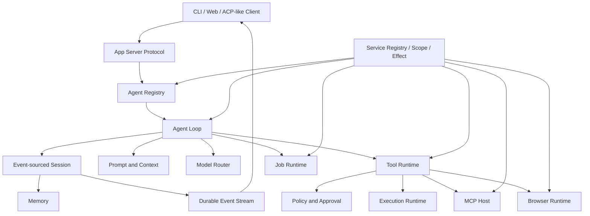

# Isla Agent Platform 基线

## 目标

Isla 是个人 Agent 产品，但需要具备完整 Agent Runtime 的基础服务。个人定位决定默认策略、隐私和交互方式，不再被用作省略 Web UI、Plan/Act、审批、扩展生命周期、MCP、后台任务、可恢复事件流或受管执行环境的理由。

本基线先固定长期边界，再分版本实现。功能可以尚未启用，但核心契约不得要求未来通过破坏性重构补上。

## 参考项目与取舍

### DeepSeek Harness / Cordis

采用：服务图、显式依赖、作用域、插件生命周期、事件扩展点、持久 Session 事件与实时事件分离、Agent 创建/恢复/销毁所有权。

调整：Isla 不直接复制 Cordis API；先在现有单包 TypeScript 项目内建立兼容的 `ServiceRegistry + Scope + Effect`，成熟后再决定是否拆包。

### OpenAI Codex

采用：App Server 作为 UI 与 Agent 的稳定协议边界；Turn/Item 事件；命令、文件修改、网络和 MCP 分类型审批；Sandbox 与 Approval 分离；长命令进程句柄；用户输入请求；MCP elicitation；可恢复 Thread/Turn。

调整：Isla 保持本地优先和多 Provider，不绑定单一云账户。

### OpenHands

采用：CLI、Headless、Web 三种界面共享 Runtime；会话恢复；确认模式；MCP 管理；运行时隔离；计划可见；长任务状态。

调整：不复制其容器架构，执行环境以本地 Workspace、受管工具链和可选容器适配器并存。

### Cline

采用：Plan/Act 是真正权限模式，不只是提示词；模式切换保留上下文；Checkpoint；客户端协议承载模式、模型、审批和会话恢复。

调整：Plan 默认只读，但允许显式的安全诊断命令；进入 Act 必须由用户或可信策略确认。

### SWE-agent

采用：环境与工具安装分离、命令可用性探测、安装/执行超时、结果驱动的循环。

调整：依赖安装使用受管 Manifest 和 Approval；模型不能注入任意远程脚本。

## 必备服务图

## 核心契约

### Service Registry、Scope 与 Effect

- 服务通过稳定 key 获取，不从业务模块直接导入具体实现。
- 服务声明 required/optional dependencies，由 Runtime 拓扑启动。
- Host、Session、Agent、Turn、Task 都有 Scope。
- 注册、订阅、进程、MCP 连接、浏览器上下文和临时目录必须登记 Effect，并按 Scope 逆序释放。
- 插件失败只影响自身 Scope；核心服务失败进入明确降级或终止状态。

### Agent 与 Session

- Agent 是有生命周期的执行实体；Session 是持久事实，不是同一个对象。
- Session 使用 append-only 事件：turn、step、message、tool call/result、approval、question、plan、checkpoint、job reference、terminal outcome。
- 投影产生聊天记录、任务状态、上下文、计划、证据和 UI 时间线。
- 每个 Tool Call 必须有唯一结果；未知结果必须记录 `outcome_unknown`，恢复时先核对副作用。

### Turn 与实时协议

- App Server 提供稳定的 Thread/Turn/Item 协议，CLI 和 Web UI 都是客户端。
- 实时流带可恢复 cursor；断线后可从最后 cursor 续传。
- Turn 支持 start、steer、follow-up、cancel、interrupt、resume。
- 一个 Turn 只允许一个持久终态；流式文本和持久消息分别管理。

### Plan / Act

- `plan`：只读文件、搜索、上下文和安全诊断；禁止写文件、安装依赖和外部副作用。
- `act`：按 Policy、Sandbox 和 Approval 使用完整能力。
- Plan 是结构化持久对象，包含目标、约束、步骤、验证、风险和开放问题。
- 模式切换是 Session 事件和权限快照变化，不只是 System Prompt 文本。
- 执行中遇到重大假设失效可回到 Plan；普通失败由 Recovery 自动处理。

### Policy、Sandbox 与 Approval

- 分开处理文件读、文件写、命令、网络、MCP、凭据、依赖安装和权限提升。
- 支持单次批准、本 Turn 记住、本 Session 记住和持久规则；持久规则必须可查看和撤销。
- Approval 展示规范化命令、工作目录、网络目标、文件范围和理由。
- 自动批准策略只缩小提示频率，不能扩大 Sandbox。
- 非交互模式必须显式配置策略；不能把 EOF 当作模糊拒绝。

### Execution Runtime

- 统一 `exec/start`、`exec/write`、`exec/read`、`exec/cancel`，支持 PTY、长进程、输出 cursor、超时和退出事实。
- 执行目标由 Adapter 提供：本机 Workspace、受管工具链、容器、远程主机。
- 平台信息和可执行文件事实由 Runtime 提供，模型不使用 `which/where/ls` 猜测环境。
- Dependency Manager 支持系统包管理器和固定来源下载；下载需哈希、受管目录、原子安装、版本验证和卸载。

### MCP

- stdio、Streamable HTTP；SSE 仅兼容需要时提供。
- tools、resources、prompts、elicitation、OAuth、server health、lazy start、hot reload。
- MCP Tool 继续经过 Isla Policy 与 Approval；远程内容一律不可信。
- 配置、凭据、缓存目录与 Session 事实分离。

### Browser 与 Web

- 搜索、抓取、交互浏览器分层；交互浏览器支持截图、DOM/可访问性树、下载、上传和人工接管。
- 网络目标受域名/协议策略控制；登录和凭据使用单独批准。
- Browser action、下载和页面状态成为可验证事实。

### Job、Subagent 与后台工作

- Job 有稳定 ID、输入、状态、进度、等待用户、产物、取消和恢复。
- 对话断开不取消持久 Job；结果只在订阅或用户再次询问时带回。
- Subagent 是受父 Agent 所有的 Agent Scope，拥有独立上下文和受限能力；不是任意递归。
- 初期只支持一层、显式预算和确定性汇总；并行 Tool 与 Subagent 共享调度限额。

### Web UI

- 主 Agent Web UI 使用 App Server，不直接读取 Session 文件或数据库。
- 最低功能：会话列表、实时 Turn、审批/提问、Plan、工具时间线、文件/Artifact 预览、Job、Memory、MCP、设置和诊断。
- Web UI 与 CLI 行为等价，差别仅是呈现。

### Observability 与评估

- Trace 关联 sessionId、turnId、stepId、toolCallId、jobId 和 approvalId。
- 记录有界元数据、耗时、token、重试、错误分类和验证结论，不记录秘密。
- 提供可重放的脱敏场景夹具、回归评分、Provider 契约测试和故障注入。

## 当前能力差距

| 基础服务 | 当前 | 目标 |
|---|---|---|
| Agent Loop | 已有闭环、恢复和完成门禁 | 事件化 Agent 生命周期与可插拔拦截点 |
| Session | JSON 消息、Journal、Task State | append-only event log + projections |
| Plugin | 仅 Provider `setup` | Service/Scope/Effect 完整生命周期 |
| CLI/Host | 实时 Turn、远程审批 | 可恢复 App Server 协议与多客户端 |
| Web UI | 只有 Resource UI | 主 Agent Web UI |
| Plan | Task State 和隐式规划 | 权限约束的 Plan/Act 模式 |
| Approval | CLI/远程一次性批准 | 分类审批、规则、记住与撤销 |
| Command | 前台一次性命令 | 长进程、PTY、stdin、cursor、执行 Adapter |
| Dependency | 初始固定包管理器实验 | Manifest、下载、校验、受管安装、卸载 |
| MCP | 本地 stdio tools | HTTP/OAuth/resources/prompts/elicitation/热重载 |
| Browser | Playwright 与接管 | 完整 Artifact、下载和证据链 |
| Job | Resource Job | 通用后台 Job 与订阅 |
| Subagent | 无 | 一层受限子 Agent 与预算 |
| Checkpoint | Context checkpoint | Workspace checkpoint/恢复 |
| Evaluation | 单元/烟测 | 场景回放、评分和故障注入 |

## 实施路线

### v0.7.0 Runtime Kernel

实现 Service Registry、Scope、Effect、Agent Registry 和统一生命周期；为现有 Provider、Tool、MCP、Browser 建适配层。外部行为保持兼容。

验收：依赖拓扑启动；失败回滚；Scope 释放无泄漏；现有测试全过；旧 CLI/Host 无行为回归。

### v0.7.1 Event Session 与 App Server

引入 append-only Session Event V1、投影和 cursor；Host 升级为稳定 App Server；CLI 改为协议客户端。

验收：重启恢复、断线续传、崩溃中 Turn 修复、唯一终态、多客户端只读跟随。

### v0.7.2 Policy / Approval / Execution

分类审批、规则存储、命令规范化、长进程、PTY、stdin、平台事实、受管依赖安装和执行 Adapter。

验收：真实通用任务经显式 Approval 后执行 argv 命令，读取输出并核验退出状态；未知副作用不盲目重试；跨平台 Adapter 契约测试。PDF 专项验收已从该版本范围移除。

### v0.7.3 Plan / Act 与 Checkpoint

结构化 Plan、模式权限快照、显式切换、执行进度、回到规划、Workspace Checkpoint。

验收：Plan 不能写；Act 继承已批准计划；失败可重规划；Checkpoint 可预览和恢复。

### v0.8.0.0 主 Agent Web UI

会话、实时 Turn、审批、Plan、工具、Artifact、Job、Memory、MCP、设置和诊断。

验收：核心操作与 CLI 等价；刷新/重连不丢状态；秘密不进入浏览器持久缓存。

### v0.8.1.0 评估、安全与发布门禁

真实任务套件、故障注入、性能/资源门禁、迁移测试、插件兼容测试和安全回归。

### v0.8.2 MCP 完整客户端

HTTP/OAuth/resources/prompts/elicitation、健康状态、lazy start、热重载和按 Server/Tool 审批。

### v0.8.3 Job 与 Subagent

通用持久 Job、通知订阅、一层 Subagent、预算、取消和汇总。

## 迁移规则

- 先加兼容层，再迁移调用方，最后删除旧实现。
- 每个持久 schema 都有版本、迁移和崩溃恢复测试。
- 新服务必须声明 ownership、dependencies、scope、failure policy、persistence、protocol 和 observability。
- 不以“当前未使用”拒绝基础契约；可以推迟具体 Adapter，但接口和生命周期必须先稳定。
- 不直接复制外部项目目录或源码；可复用成熟协议、库和可独立依赖。

## Resource 冻结边界

本轮重构不修改 Resource Service 的 SQLite schema、Scheduler、Job 状态机、下载/解压 Runner、Worker 推理协议和现有 HTTP API。主 Agent 新架构只能通过以下方式接入 Resource：

- 保留现有 `ResourceBridgeClient` 和六个窄 Tool；
- 在 App Server 中增加 Resource Job 的只读投影和现有操作的协议转发；
- 使用适配器把 Resource 事件映射为主 Agent UI 事件，不把 Resource 数据迁入 Session Event Store；
- Resource 失败继续独立降级，不阻止主 Agent 启动。

只有发现明确的安全漏洞、数据损坏或阻断兼容迁移的缺陷时，才允许修改 Resource 内部；修改必须单独计划和验收。
