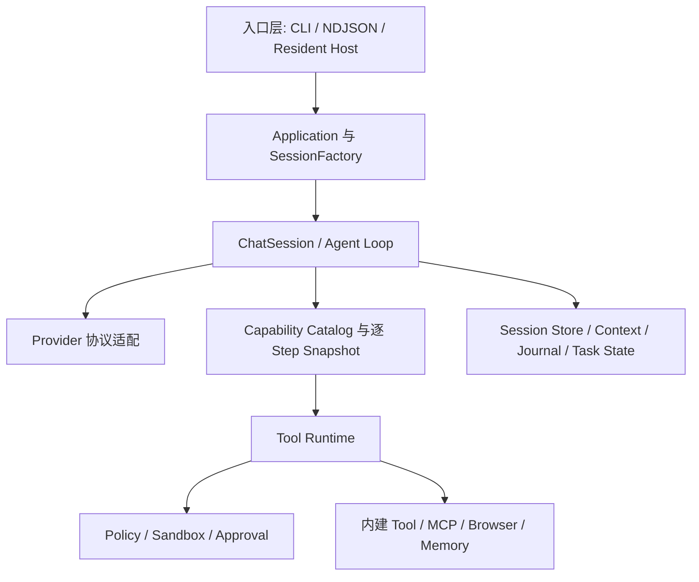
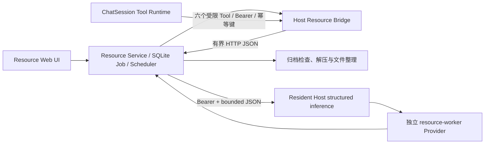
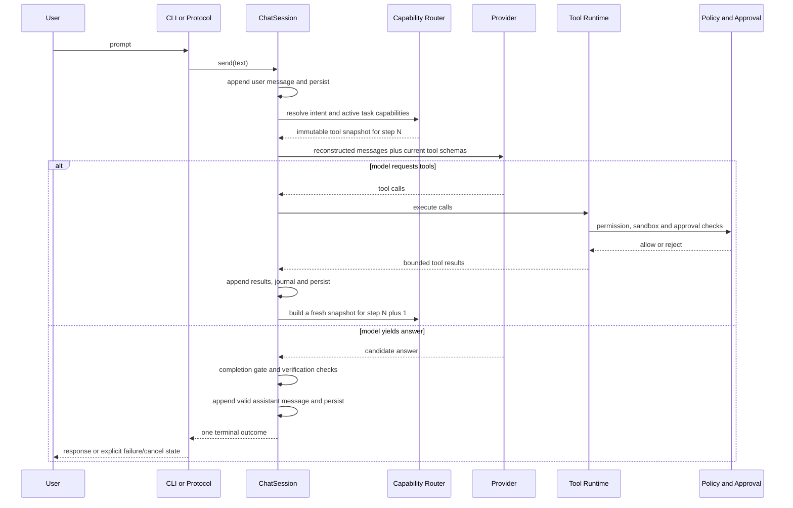
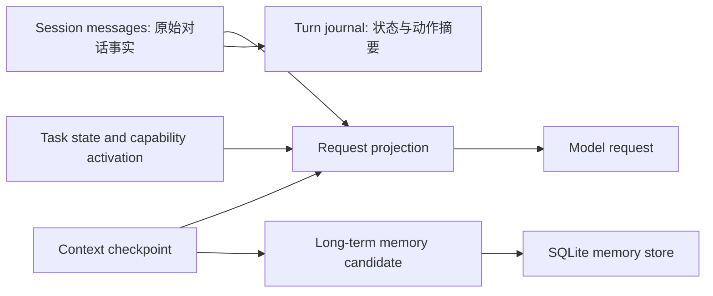

# Isla 当前架构

本文以 `0.6.0` 源码和测试为事实源，描述主 Agent Runtime 与独立 Resource 工具子系统的当前稳定边界。

## 产品定位与原则

Isla 是面向个人使用的 TypeScript/Node.js Agent Runtime。无参数 CLI 与一次性 prompt CLI 默认作为 Resident Host 客户端；`--local` 保留进程内故障恢复入口。Host 只监听 loopback，并持有 Session、Memory、Approval 和 User Question；Resource 则以独立进程提供下载、解压、整理和专用 Web 工具台。个人定位决定默认策略、隐私与产品体验，但完整 Agent 基础服务按 [Agent Platform 基线](./agent-platform-baseline.md) 演进，不再以当前规模为由省略长期必需的核心契约。

核心原则：

- Config/Profile 是正常运行的配置事实源；`.env` 只用于显式开发、CI 或迁移兼容。
- Provider 表示协议适配，模型、Base URL 与凭据属于 Profile 连接配置。
- 用户消息在调用模型前写入会话；只有有效模型回答进入 assistant 历史。
- 原始 Session 是事实，Context 压缩只改变模型输入投影。
- Capability 激活只决定工具可见性，不代表批准执行，也不能绕过 Policy、Sandbox 或 Approval。
- CLI、NDJSON 和 Host 复用同一个 Application、SessionFactory 与 Runtime。
- Resource Service 不复用主 Agent Loop；它通过窄结构化推理 API 请求 Worker 建议，文件操作仍由确定性脚本和 Job 状态机执行。

## Runtime 分层

依赖方向由入口向核心和端口适配器流动。`src/core/` 不拥有 CLI、HTTP、Playwright 或具体 Provider 的生命周期；装配集中在 `src/entrypoints/` 与 `src/runtime/`。

Resource 位于主 Agent Runtime 之外。v0.6.0 仅由 Resident Host 装配 `ResourceBridgeClient`，经 `runtime.json` 中的 loopback 地址和进程间令牌调用 Resource API；CLI、本地模式和主 Agent 不直接打开 Resource SQLite 或 Scheduler。Resource 健康失败只隐藏/降级该 Capability，不阻止普通对话。

Agent Job 创建在 Resource SQLite 的幂等事务中写入稳定 Job 引用；Agent Tool 只接收安全 Job 快照和 Artifact 元数据。Resource SQLite 仍是 Job 状态事实源，Session 不是后台任务日志。密码、分享码与验证码不通过 Agent Tool 传递，继续使用 Resource UI 的秘密输入路径。

Resource 是独立工具子系统，不是主 Agent Runtime 的第二套实现。它可以在 Worker 不可用时继续走规则或人工路径；Worker 不拥有 Session、Memory、Tool、Capability、文件系统权限或多轮 Agent Loop。

## 核心模块职责

| 模块 | 职责 |
|---|---|
| `src/entrypoints/cli.ts` | 轻量 Host 客户端、显式 `--local` 模式和 NDJSON 开发入口。 |
| `src/entrypoints/host.ts` | 常驻 Resident Host 组合根。 |
| `src/entrypoints/resource.ts` | 常驻 Resource Service 组合根。 |
| `src/runtime/bootstrap.ts` | 加载 Config/Profile，创建 Provider 与 MCP Host 并注册到 Runtime。 |
| `src/runtime/application.ts` | 聚合 Runtime、Session Store、Memory、诊断与关闭生命周期。 |
| `src/runtime/session-factory.ts` | 按 workspace 和当前会话组装 Session、能力目录、Browser、MCP、Memory 与持久化回调。 |
| `src/core/session.ts` | 会话事实、Agent Loop、请求投影、工具轮次、完成门禁、压缩、终态与持久化。 |
| `src/core/work-plan.ts`、`src/tools/control.ts` | Runtime-owned Plan identity/status、分离的 plan proposal/progress 输入、revision 精确用户批准和证据校验后的结算。 |
| `src/core/model-step.ts` | 单次 Provider 调用、流式/非流式选择、重试事件与候选结果。 |
| `src/capabilities/catalog.ts` | Host-owned manifest、可用性、检索与能力 Provider。 |
| `src/capabilities/routing.ts` | 确定性预选、Task 激活状态、逐 Model Step Tool Snapshot 和能力元工具。 |
| `src/tools/` | Tool 契约、组合、执行、权限分类及内建能力。 |
| `src/mcp/` | Profile 配置的 stdio MCP Server 生命周期、目录映射、调用与诊断。 |
| `src/browser/` | Playwright 会话、URL 策略、人工接管 Console 与凭据批准。 |
| `src/memory/` | SQLite 长期记忆、Core Memory、检索、可选 Embedding 与检查点候选。 |
| `src/sessions/store.ts` | JSON Session schema、兼容迁移与原子持久化。 |
| `src/protocol/` | stdin/stdout NDJSON 请求、事件、Approval 与用户问题。 |
| `src/sandbox/`、`src/approval/` | workspace 路径边界、敏感文件拒绝、操作权限和用户批准。 |
| `src/entrypoints/resource.ts` | 加载独立 Resource 配置，装配百度网盘、归档工具、Host 推理客户端并启动 Resource Service。 |
| `src/resource/service.ts` | Resource HTTP API、SQLite Job、人工决策、下载/解压流程和专用 Web UI 生命周期。 |
| `src/resource/scheduler.ts` | 下载、检查、解压和推理的独立并发池、租约与取消收敛。 |
| `src/resource/inference.ts` | Host 侧专用提示、模型调用和三类结构化结果校验。 |
| `src/resource/inference-client.ts` | Resource 到 Resident Host 的窄 HTTP 客户端；不接触 Provider SDK 或凭据。 |
| `resource-ui/src/main.tsx` | React Resource 工具台入口，不是主 Agent Web 界面。 |

## 用户请求完整链路

用户输入先成为 Session 事实，因此实际发给模型的消息可以从会话重建。Provider 错误、取消、空回答或被完成门禁拒绝的候选不会伪装成成功的 assistant 消息。

Resident Host 的一次性 `/quick` 请求可由客户端显式选择 NDJSON。Host 为每次 Turn 生成 `turnId`，事件流只观察模型步骤、文本增量和不含参数的 Tool 阶段；`sessionId + turnId` 是精确取消身份。流只允许一个终态，且不会成为第二份持久 Session 历史。客户端断开和 Host shutdown 都通过当前 `ChatSession` 的协作取消收敛。

## Capability 与 Tool

SessionFactory 将内建 `ToolCapability`、Profile 已配置的 MCP 能力和 Browser 能力注册到 `CapabilityCatalog`。Manifest 提供稳定 ID、摘要、关键词、风险、生命周期和需求；Catalog 负责可发现性，不执行工具。

每个任务保存 `CapabilityActivationStateV1`。Runtime 根据用户输入、已有激活状态和必须包含的元能力做确定性预选；页面内容等不可信指令不能触发非只读能力。模型也可调用：

- `capability_search`：只搜索摘要；
- `capability_activate`：激活已知且可用的能力，从下一 Model Step 生效；
- `capability_status`：查看可用、拒绝和激活状态。

每个 Model Step 都重新生成不可变 Snapshot。只有 Snapshot 中能力的 Tool Definition 会发给模型。激活后实际调用仍经过 Tool Runtime 的工具查找、权限分类、Sandbox、Approval、取消和结果规范化。

## Session、Context、Journal 与 Memory

- Session Store 保存消息、Context、Journal、Task State、Skill Catalog 与 Capability Activation；workspace key 隔离发现和恢复。
- Context 在预算压力下裁剪可重新获取的旧 Tool 结果，并为闭合旧轮次生成 checkpoint；不删除原始 Session 消息。
- Journal 保存回合、模型尝试、工具动作、检查点和终态的结构化摘要，不以私人正文替代 Session。
- Memory 是独立持久层；检索失败可降级，不得让记忆不可用破坏基本对话闭环。

## Provider 边界

`IslaRuntime` 注册 OpenAI、DeepSeek、Bailian 和 OpenAI-compatible local Provider。Provider 接收统一 ModelRequest，声明 tool calling、native streaming 与 streaming tool calls 等能力，并把平台响应映射为统一结果。一次进程启动后 Provider 和模型保持固定；模型切换写入 Profile 后下次启动生效。

## MCP 与 Browser 边界

MCP Host 消费 Profile 显式配置的 stdio 与 Streamable HTTP Server，HTTP endpoint 要求 HTTPS（loopback 可用 HTTP），由官方 TypeScript SDK 管理 MCP 握手与协议；同源重定向策略阻止凭证跨源转发。MCP 工具、已列出的只读 Resources 和 Prompts 以受限 Capability 暴露，外部 schema/description/instructions/结果均视为不可信，并继续经过现有 Policy、Approval 和 Tool Runtime。`tools/list_changed`、`resources/list_changed`、`prompts/list_changed` 会触发单 Server 有界重新发现与目录原子替换，刷新失败时撤下该 Server 目录。Form Elicitation 使用 SDK 的现代 `input_required` 与旧版 Form 请求处理器，绑定当前回合的 UserQuestionService；同一 Server 上可交互请求串行执行，避免并发回合答案串线，缺少交互或无法表达/验证的 Schema 会拒绝请求。OAuth 授权交互与持久化 Token 仍未完成：Host 启动时连接早于用户交互，且 Resident Host 与 WebUI 浏览器可能不在同一设备，安全 callback 路由需另行确定。运行期热重载未实现；不提供在线安装。

Browser 使用隔离的 Playwright 上下文和 URL Policy。Browser Console 仅监听 loopback，用于人工接管；凭据使用需要独立批准，明文不进入模型、Session、Tool Result 或普通日志。Browser 能力不等于任意网络或任意 JavaScript 权限。

## Resource 与 Worker 边界

Resource Service 使用独立配置、SQLite Job、Scheduler 和受管目录边界。当前支持百度网盘下载、归档识别与解压、目录整理、任务恢复、人工确认和专用 Web 工具台。下载、检查、解压和推理使用分离的并发池，长任务不进入主对话回合。

当确定性规则无法可靠解析分享信息、判断目录语义或生成标题时，Resource 可调用 `POST /api/v1/inference/structured`。Resident Host 从 Config 中独立解析 `workerProfile`，固定 provider、model、profile 和 config revision 快照，并只接受三个任务：

- `resource.parse-share-text`；
- `resource.identify-content`；
- `resource.suggest-title`。

所有输入和输出都经过有界 schema 校验。规则事实优先于模型建议；Worker 建议仍需名称清理、路径与事实一致性检查以及必要的人工确认。Worker 未配置、不可用、超时或输出非法时，不回退占用 primary 模型，也不使已有规则路径失效。

`src/web/`、主 Agent Web UI 与 Resource Web UI 是三个不同概念：`src/web/` 提供主 Agent 可用的联网搜索、抓取、传输与网络策略能力；`agent-ui/` 是通过 Resident Host App Server API 交互的本地主 Agent 工作台，构建产物由 Host 按配置静态托管，loopback bootstrap 只向同源页面提供本机 Bearer token；`resource-ui/` 则是 Resource Service 的独立操作页面。主 Agent Web UI 已提供会话搜索与归档/恢复，归档时间保存在 Session JSON v7，归档会话不参与默认恢复或新 Turn；follow-up 由 Host 暂存于活动 Turn，在前一 Turn 成功后以新 Turn ID 串行执行，并以请求 ID 去重，Host 重启不恢复队列。执行器状态和有界 cursor 输出通过 owner/session/workspace 校验投影到 Agent UI，不暴露执行 argv 或绝对路径。当前仍缺远程 steer、Artifact 预览、完整配置管理、多客户端一致性验收和自动化浏览器安全测试，不能视为与 CLI 能力完整等价。Act 的最终提交仅在 Runtime 能将每个计划步骤映射到不同的成功工具证据时自动结算进度；change/verify 步骤分别要求实际文件变更/通过的验证证据，证据不足仍拒绝完成。Resource Service 不再保留内嵌旧页面；静态产物缺失时会返回明确诊断。

## 安全与审批

安全控制是串联关系而不是互相替代：

1. Profile 决定能力和 MCP 的配置边界；
2. Capability Policy 决定可发现和可暴露的范围；
3. Tool Runtime 根据 permission 执行或发起 Approval；
4. Sandbox 将文件读写限制在 workspace，并拒绝敏感路径；
5. 外部研究完成门禁要求真实成功的 Web Search、Web Fetch 或 Browser 读取证据，HTTP 非 2xx 不计为证据；
6. Journal 和诊断只记录安全摘要，秘密与原始私人内容不得进入日志。

## 部署边界

原生 Node.js、容器、systemd 或 launchd 只负责进程托管。Runtime Core 不感知部署环境。Resident Host 仅绑定 loopback、使用 Bearer token、限制并发回合并在关闭时取消和收敛活动会话；Resource Service 也保持独立进程和本地受控入口。两者都不是公网或多用户服务。

## 当前尚未实现但已进入架构基线

- 运行期间动态切换 Provider/Model；
- 在线插件安装、任意代码动态加载和热更新；
- MCP 远程 transport、OAuth、resources、prompts 和 elicitation；
- Embedding 或独立模型驱动的能力路由；
- 并行 Tool、一层受限 Subagent 和通用持久 Job；
- Worker Session、Memory、Tool、文件系统权限或开放式 Agent Loop；
- Service/Scope/Effect 插件内核、完整可恢复 App Server、Plan/Act 贯通闭环、长进程和 Workspace Checkpoint。

公网多用户、无边界 Agent Team、任意递归和自主演化仍不属于个人 Agent 基线。

## 架构修改约束

新增抽象必须由现实需求驱动；入口应复用 Application、SessionFactory 和核心契约；新能力必须声明配置、风险、权限、取消、持久化、协议和测试边界。若修改模型输入、Session 事实、终态、Approval 或 Sandbox 契约，必须先更新设计决策并取得确认。
