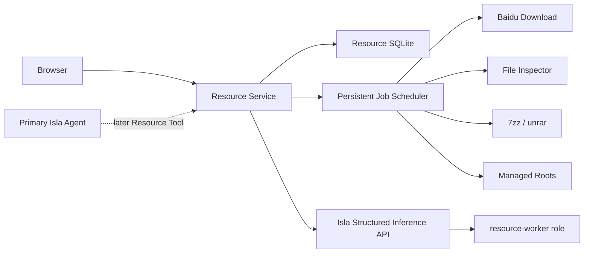

# v0.5.0 总体设计

## 1. 现实问题

Isla 已具备模型、工具、安全和会话基础，但资源下载与整理包含长时间下载、文件检测、密码尝试、压缩处理、人工确认和断点恢复。它不能被表达为一次 ChatSession Tool Call，也不能让下载或解压阻塞主 Agent 进程。

同时，用户需要一个可持续扩展的私人工作台。v0.5.0 以 Resource 为第一个工具箱，但只建设被当前需求直接驱动的边界。

## 2. 产品形态

首版提供独立 Resource Web 页面，面向桌面浏览器，不要求移动端或多尺寸专门适配。页面工具箱包含两个独立入口：`百度下载` 与 `文件解压/整理`。用户可以：

- 粘贴混合分享文本；
- 选择受管输出目录；
- 预览规则与 Worker 解析结果；
- 同时创建多个下载任务；
- 查看排队、下载、检测、解压和整理进度；
- 处理登录、验证码、密码、冲突和低置信度确认；
- 浏览最终输出目录与文件清单。
- 在两个工具中分别选择受管输入/输出目录；百度下载的输出可直接作为解压整理的输入。

Isla 主聊天 Web UI 是 v0.5 的产品方向，但不作为首个 Resource 发布门禁。Resource API 和 UI 不依赖主聊天 React 状态，后续可嵌入工具箱右栏。

## 3. 进程边界



### Isla Host

负责：

- Config/Profile 与 Model Role；
- Provider 实例生命周期；
- Primary Agent；
- Worker 结构化推理；
- 结构化输出 schema 注册、校验、超时、取消和安全诊断。

### Resource Service

负责：

- Web/API；
- Job 与事件持久化；
- 多队列调度；
- 百度网盘下载；
- 受管目录扫描；
- 文件稳定性判断；
- 文件类型、拼接数据和分卷检测；
- 密码候选测试；
- 安全解压；
- 输出目录选择、冲突处理和执行报告。

Resource Service 不读取 Isla API Key，不加载 Provider SDK。Isla Host 不理解百度网盘、RAR 或资源目录。

### 工具边界与无模型兜底

- `百度下载` 拥有分享文本规则解析、百度 runner、下载队列和下载目录；
- `文件解压/整理` 拥有目录扫描、归档识别、分卷、解压、命名和发布；
- 两个工具共享 SQLite Job、事件流、受管目录和阶段资源池，但不共享具体外部命令适配器；
- Web UI 分别显示输入区、目录选择器、队列和结果，串联只是显式传递 artifact，不是隐藏耦合。

模型是可选增强：规则先行，Worker 只处理规则无法确定的混合文本、异常链接表述、低置信度密码候选和命名建议。Worker 不可用时不得阻止任务进入确定性阶段；无法判断的字段进入人工确认，并记录脱敏的未识别模式，后续补充规则回归样本。

## 4. Model Role

Config 增加命名模型角色：

```ts
interface ModelRoleBindingV1 {
  readonly profile: string;
  readonly model?: string;
}

interface ModelRolesV1 {
  readonly primary: ModelRoleBindingV1;
  readonly "resource-worker": ModelRoleBindingV1;
}
```

- `profile` 引用现有 Profile；
- 可选 `model` 只在用户明确覆盖 Profile 模型时使用；
- Config 保存仍使用现有原子写入和 revision；
- Role 修改对新推理请求生效；
- 已开始请求不切换模型；
- Resource Job 保存 `role/profile/provider/model/configRevision` 快照；
- Worker 无 Session、Memory、Tool、Capability 与文件系统权限；
- Worker 输出必须通过服务端注册 schema 校验，最多进行一次格式修复重试。

这属于多模型角色，不是完整多 Agent。

## 5. Resource 配置

Resource 使用独立配置文件，例如 `~/.isla/resource.json`，避免把目录、并发和扫描设置混入 Provider Profile：

```json
{
  "version": 1,
  "listen": { "host": "127.0.0.1", "port": 43120 },
  "isla": { "baseURL": "http://127.0.0.1:43118", "tokenFile": "..." },
  "database": ".../resource.sqlite",
  "stagingRoot": ".../resource-staging",
  "managedRoots": [
    {
      "id": "library",
      "path": ".../library",
      "label": "资源库",
      "autoIngest": true,
      "scanIntervalSeconds": 60,
      "settleSeconds": 30
    }
  ],
  "concurrency": {
    "downloads": 2,
    "inspections": 2,
    "extractions": 1,
    "inference": 2
  }
}
```

路径示例不能成为默认绝对路径。首次设置由用户选择。服务端只接受 `managedRootId`，不接受浏览器提交任意系统目录。

## 6. 受管目录模型

Resource 像“养在文件夹里的管理器”：

- 用户配置一个或多个受管根目录；
- 创建下载任务时选择目标根；
- 下载和解压始终先进入任务独立 staging；
- 全部验证成功后才发布到目标根的 Job 输出目录；
- 用户手工放入受管目录的新文件也能被周期扫描发现并创建 ingest Job；
- 定期整理只处理已经稳定、未被占用且未登记完成的文件；
- 不自动接管 `.partial`、`.tmp`、下载器临时文件或正在变化的文件；
- 不依据一次 `fs.watch` 事件直接开始解压。

每个文件保存相对路径、size、mtime、稳定观察次数和可选 hash。Windows/Linux 上统一以扫描和 ledger 去重。

## 7. 并发模型

并发不是“整个 Job 并行跑到底”，而是分阶段资源池：

- Download Pool：默认 2，可配置，允许多个任务同时下载；
- Inspection Pool：默认 2；
- Extraction Pool：默认 1，避免 N100 磁盘和 CPU 被多个大型解压占满；
- Inference Pool：默认 2；
- 同一 Job 同一阶段只有一个 lease owner；
- 同一 archive group 不能被两个 Job 同时处理；
- 调度器按创建时间公平排队，不允许单个 Job 无限占用重试槽；
- 取消通过 AbortSignal 传递给 HTTP、下载子进程、7zz/unrar 和推理请求。

并发值改变只影响新取得 lease 的工作，不中断当前子进程。

## 8. 百度网盘范围

v0.5.0 只支持百度网盘。实现使用具体 `BaiduPanClient`/`BaiduPanDownloadRunner`，不提前定义通用 Downloader 抽象。

开始实现前必须实测并记录：安装方式、Linux/Windows 支持、登录状态、转存、下载、进度输出、退出码、会员权益、验证码和风控行为。若 `bdpan-storage` 不满足要求，可以更换具体实现，但不得绕过平台限制。

Schema 的 `source` 首版只允许 `baidu`。未来来源只在文档中占位，不提供未使用的工厂、注册表或抽象层。

## 9. 文件检测与解压

检测顺序：

1. 文件稳定并关闭写入；
2. 读取文件头和必要尾部窗口；
3. 识别 RAR4、RAR5、ZIP、7z 与媒体容器；
4. 扫描内部压缩签名并排除明显误报；
5. 对 MP4 尾部候选切割到 staging 临时文件；
6. 用 `7zz t` 验证，复杂 RAR 回退 `unrar t`；
7. 识别分卷并建立 archive group；
8. 按规则候选和 Worker 结果尝试密码；
9. 列表预检路径、文件数、展开体积和压缩倍率；
10. 解压到 Job staging；
11. 完整性验证后原子发布到用户选择的输出根。

所有外部命令使用 `spawn(executable, argv)`，不拼接 shell 字符串。密码、Cookie、Token 和登录数据不得进入 argv 诊断、普通日志或 Web 事件。

## 10. 输出和整理

每个任务选择 `managedRootId`。默认发布目录：

```text
<managed-root>/<safe-title-or-job-id>/
```

命名优先级固定为：用户显式命名 → 分享文本中规则识别的有用标题（优先保留汉字）→ Worker 基于下载信息/内容给出的建议 → 下载文件名或归档内稳定名称 → 用户确认 → `resource-<解压完成时间>`。纯时间戳、长哈希、乱码和无意义通用名不作为高置信度名称。目录名必须经过确定性清理；模型只提供建议。遇到重名、覆盖、跨文件系统移动或低置信度命名时进入人工确认。首版完成条件是得到完整解压内容和清单，媒体库分类、刮削和复杂重命名不是阻断项。

## 11. Web 与事件

Resource Web 使用同源 HTTP API 与 SSE：

- 创建任务、确认、取消、重试使用普通 HTTP；
- 任务阶段、字节进度、文件事件和人工请求使用 SSE；
- 页面刷新后通过 REST 快照恢复，再从最新 event cursor 继续订阅；
- 事件不是唯一事实源，SQLite Job/Artifact/Decision 表才是事实源。

第一版桌面页面包括两个工具卡片/页签、各自的输入和输出目录选择器、任务列表、任务详情、人工确认和输出文件清单。浏览器只能从服务端公布的 managed roots 中选择，不能提交任意系统路径。

## 12. 安全边界

- 私人 LAN 不等于可信输入；默认 loopback，显式配置后才能监听 LAN；
- 浏览器不获取 Isla 内部 Token、Provider Key、百度凭据或解压密码；
- Resource 到 Isla 使用独立服务 Token；
- 所有可写路径必须位于 staging 或已配置 managed root；
- 防止 archive path traversal、绝对路径、符号链接逃逸、覆盖、压缩炸弹和超量文件；
- 低置信度、登录失效、验证码、风控、文件重名和覆盖进入 `waiting_user`；
- 原始云端响应和私人任务日志保存在本地数据目录，不进入 Git。

## 13. 采用、暂缓与拒绝

采用：两个独立进程、静态 Resource 工具箱、Model Role、结构化推理、SQLite Job、阶段资源池、周期扫描、7zz + unrar、HTTP + SSE。

暂缓：主聊天 Web 完整迁移、主 Agent Resource Tool、移动端 UI、自动资源分类、其他平台、分布式 Job。

拒绝：模型直接文件操作、把 Resource 状态写入 ChatSession、通用插件市场、任意动态代码加载、只依赖 `fs.watch`、字符串 shell、自动绕过风控。
