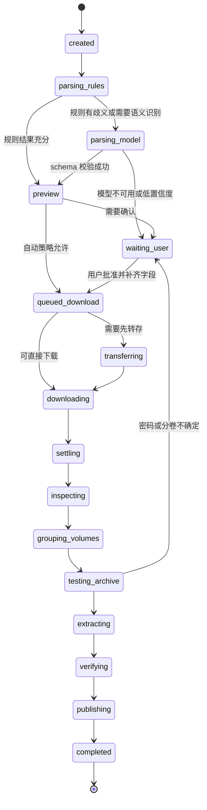
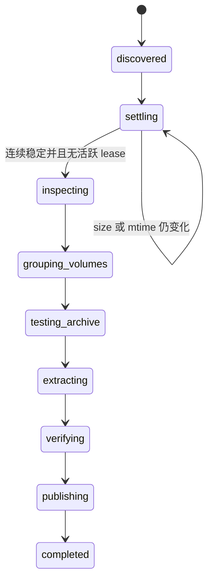

# v0.5.0 Resource 状态机

## 1. 两层状态

Job 使用稳定 `status` 表达生命周期，用 `stage` 表达资源领域进度。

```text
status: queued | running | waiting_user | cancelling | completed | failed | cancelled
stage:  created → parsing_rules → ... → publishing → completed
```

`waiting_user` 不丢失原 Stage，而是保存 `resumeStage` 和结构化 Decision。恢复时必须验证 Job revision 和外部事实是否仍有效。

## 2. 分享文本主流程



任何可取消阶段都可进入 `cancelling → cancelled`。不可恢复错误进入 `failed`；可恢复错误保存 `resumeStage`。

## 3. 受管目录发现流程



周期扫描是权威发现机制：

1. 枚举配置根目录；
2. 排除 staging、发布目录、忽略规则和临时扩展名；
3. 与 File Ledger 对比；
4. 新文件记录 `discoveredAt/size/mtime`；
5. 连续满足 settle 条件才创建或唤醒 Job；
6. 相同 fingerprint 已完成时不重复处理；
7. `fs.watch` 事件只触发提前 scan，不直接创建 Job。

当前首版已实现周期 reconciliation，尚未接入 `fs.watch` 提前唤醒。手工扫描作为用户显式动作可立即为当前归档创建 Job；周期扫描必须至少连续两次观察到相同 size/mtime。

## 3.1 解压后的目录整理

- 删除解压结果中的空目录；
- 任意目录恰好只包含一个明确的无意义包装目录时，可递归把包装目录的内容提升一层；最外层与归档同名的单目录也可提升；
- `第一季` 等有意义名称不会被拍平；
- 最外层存在多个文件或目录时保留原结构，以保护系列和分组资源；
- 原压缩文件不因整理成功而删除，File Ledger 负责避免重复处理。

## 4. 并发与 Lease

SQLite 保存 `leases`：

```ts
interface JobLeaseV1 {
  readonly jobId: string;
  readonly pool: "download" | "inspection" | "extraction" | "inference";
  readonly ownerId: string;
  readonly acquiredAt: string;
  readonly expiresAt: string;
  readonly heartbeatAt: string;
}
```

- 获取 lease 和改变 Stage 必须处于同一事务；
- Worker 定期 heartbeat；
- 进程重启后，过期 lease 可被回收；
- 回收前检查子进程是否仍存在和输出文件是否仍在变化；
- 同一 Job 同一时刻最多持有一个阶段 lease；
- Download Pool 必须允许至少两个 Job 并行；
- Extraction Pool 默认单并发，但配置可调；
- 每个 Pool 独立排队，下载中的任务不会占用推理或解压槽。

## 5. Stage 进入与退出条件

| Stage | 进入条件 | 成功退出证据 |
|---|---|---|
| `parsing_rules` | 收到分享文本 | 规则候选和解析版本已持久化 |
| `parsing_model` | 需要语义消歧 | schema-valid 输出和模型快照 |
| `preview` | 有可展示解析结果 | 自动通过或用户 Decision |
| `queued_download` | 输入已确认 | 调度 lease |
| `transferring` | 来源要求转存 | 稳定云端目标标识 |
| `downloading` | 已获得下载 lease | 下载器成功、大小和文件清单 |
| `settling` | 有本地文件 | 连续稳定观察、无临时写入 |
| `inspecting` | 文件稳定 | 每个文件的格式/签名/候选 offset |
| `grouping_volumes` | 已完成检测 | archive group 与缺失卷结论 |
| `testing_archive` | 有 archive group | 引擎、密码、列表和安全预算通过 |
| `extracting` | 测试通过 | 引擎成功和 staging 输出清单 |
| `verifying` | 解压结束 | 文件存在、大小、限制和完整性证据 |
| `publishing` | 输出可信 | 发布目录、冲突策略和最终清单 |
| `completed` | 发布成功 | 不可变完成报告 |

## 6. 人工确认

Decision 类型：

- `confirm_parse_result`
- `provide_share_code`
- `provide_archive_password`
- `resolve_volume_group`
- `choose_destination`
- `resolve_name_conflict`
- `handle_login`
- `handle_captcha`
- `handle_risk_control`
- `approve_overwrite`（首版默认不允许直接覆盖，可改名或选择新目录）

Decision 保存公开说明和可接受 action，不保存明文秘密。用户提交的密码进入受限字段，API 回应只显示 `provided: true`。

## 7. 密码候选

候选优先级：

1. 用户显式提供；
2. 规则从分享文本提取；
3. Worker schema 输出；
4. 本机成功密码库，按成功次数和最近成功排序；
5. 人工补充，成功后进入本机密码库。

去重后单个 Job 最多尝试 20 个候选。Resource 当前是本地单用户工具，允许复用成功密码，但只有确实成功解锁过归档的密码才入库；不得从失败输入建立字典，不得把候选写入日志、事件或 API 快照。密码以本地明文保存在 Resource SQLite 的受限表中，数据库整体按私人凭据保护。失败达到上限进入 `waiting_user`，用户提交后从同一个 Job 的 `testing_archive` 继续。

## 8. 拼接压缩与分卷

### MP4 尾部 RAR

- 记录候选 offset；
- 只在 staging 创建切割副本；
- 原文件保持不变；
- 对切割副本执行 archive test；
- test 失败则记录为误报，不删除原视频；
- test 成功后作为独立 Artifact 进入 archive group。

### 多分卷

- 识别 `.partN.rar`、`.rar/.r00` 和伪装分卷；
- 对卷序列进行连续性检查；
- 缺卷进入 `waiting_user` 或可恢复失败；
- 只从主卷调用解压；
- 同一组所有卷共享 archive group lease。

## 9. 取消

取消语义：

- 未开始阶段立即 `cancelled`；
- 推理使用 AbortSignal；
- 下载和解压先请求优雅终止，超时后终止进程树；
- 已下载文件默认保留在 staging，允许用户选择重试或清理；
- publishing 开始后取消必须等原子目录操作完成或回滚；
- 任何请求最多产生一个终态。

## 10. 重试和恢复

- 网络暂态错误：指数退避并带抖动，有最大次数；
- 登录、验证码、风控：不自动重试，进入人工处理；
- Isla/模型不可用：推理阶段可重试，下载/解压阶段不依赖 Isla；
- schema 无效：最多一次修复请求；
- 密码失败：在候选上限内推进，不重复已测试组合；
- 解压进程失败：保留命令版本、退出码和脱敏 stderr 摘要；
- 进程重启：从最后已提交 Stage 和 Artifact 证据恢复，不依据内存猜测。

## 11. 发布原子性

- 解压输出先位于 Job staging；
- 验证完成前目标目录不可见或标记为 incomplete；
- 同文件系统优先原子 rename；
- 跨文件系统使用 copy → fsync/校验 → rename 的显式流程；
- 发布失败不删除 staging；
- 完成报告只在目标清单确认后写入；
- 默认不覆盖已有目录。

## 12. 终态

- `completed`：完整内容已发布并生成清单；
- `failed`：无法自动继续，包含稳定错误和是否可重试；
- `cancelled`：取消已收敛，不存在活动子进程或 lease。

`waiting_user` 不是终态。Web 页面关闭、Isla 暂停或 Resource 重启都不应把任务误记为失败。
