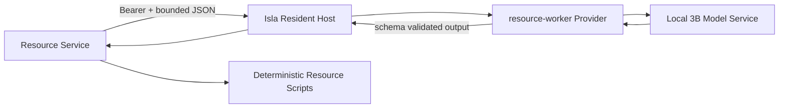

# v0.5.1 Resource Worker 生产闭环设计

## 1. 版本目标

v0.5.1 只完成一个现实需求：让 Resource 在确定性规则无法完成命名或内容判断时，调用由 Isla Config/Profile 管理的本地 3B 模型，并把经过校验的结构化建议交回现有脚本继续执行。

目标链路：

```text
Resource Job
  -> 确定性规则与脚本
  -> 仅在结果不足时请求 resource-worker
  -> 本地 OpenAI-compatible 3B 模型
  -> schema 校验与事实一致性检查
  -> 确定性状态机、人工确认或规则兜底
```

Worker 是脚本的窄增强层，不是第二套 Agent Runtime。它不拥有 Session、Memory、Tool、Capability、文件系统权限或多轮 Agent Loop，也不直接下载、解压、移动、删除或发布文件。

## 2. 现状与缺口

v0.5.0 已有以下基础：

- Config 支持独立 `workerProfile`；
- `ResourceStructuredInferenceService` 可调用一个 Provider 并要求 JSON 输出；
- Resident Host 暴露 `POST /api/v1/inference/structured`；
- Resource 配置已有 Isla endpoint、服务 token 与 inference 并发值；
- 已定义 `resource.parse-share-text`、`resource.identify-content`、`resource.suggest-title`；
- 规则解析、命名、下载、解压和人工介入在没有模型时可运行。

但生产链路尚未闭合：

- Isla 正常启动时没有按 `workerProfile` 装配第二个 Provider 并绑定结构化推理服务；
- Resource 没有 Host HTTP 客户端，配置中的 endpoint/token 未用于推理；
- Resource Job 没有在规则不足时进入 `parsing_model` 并使用 inference pool；
- 三个 Worker 任务未接入实际解析、检查和命名流程；
- 只有 `resource.parse-result.v1` 有完整运行时校验，另外两个 schema 尚未落实；
- 没有使用本地 3B 模型完成真实端到端验收。

v0.5.1 不重新设计 Resource 状态机，而是补齐上述接线和验证。

## 3. 进程与信任边界



### Resource Service 负责

- 决定是否需要 Worker；
- 生成有界、脱敏且与任务类型匹配的输入；
- 使用 inference pool、超时与 AbortSignal 调用 Host；
- 合并规则结果与 Worker 建议；
- 对建议做事实一致性检查、名称清理和人工确认；
- 在 Worker 失败时继续规则路径。

### Isla Host 负责

- 从 Config 解析独立 `workerProfile`；
- 创建并持有 Worker Provider；
- 固定单次请求的 profile/provider/model/config revision 快照；
- 使用任务对应的专用提示与 schema 校验输出；
- 返回稳定、安全的错误，不回退占用 primary 模型。

### 本地 3B 模型负责

- 从短输入中提取分享字段；
- 根据有界文件清单判断内容与目录语义；
- 给出一个或少量命名候选；
- 明确表达不确定性和需要人工确认的原因。

模型输出只是建议，不是执行授权。

## 4. 模型与配置边界

完成条件使用用户配置的本地 OpenAI-compatible 3B 模型。具体模型名称、主机 IP 和端口属于 Profile，不写入 Resource 核心或默认配置。

示意配置关系：

```json
{
  "version": 1,
  "defaultProfile": "primary",
  "workerProfile": "resource-local",
  "profiles": {
    "primary": {
      "provider": "deepseek",
      "model": "primary-model",
      "apiKey": "..."
    },
    "resource-local": {
      "provider": "local",
      "model": "local-3b-model",
      "baseURL": "http://local-model-host/v1",
      "apiKey": "local-service-key"
    }
  }
}
```

约束：

- primary 与 worker 必须分别装配，不能静默共用 primary；
- Worker Profile 未配置时，Host 返回 `ROLE_NOT_CONFIGURED`；
- Worker Profile 无法创建时，Host 启动诊断必须明确，但 CLI 主对话是否可启动沿用既有可选角色策略；
- Profile 修改只对重启后或明确规定的新装配生效，不做运行中热切换；
- API Key、真实 Base URL 和模型服务凭据不进入 Resource Job、事件、日志、文档或 Git。

## 5. 三个 Worker 任务

### 5.1 `resource.parse-share-text`

用途：规则解析后的有限消歧，不替代 URL、分享码和密码的确定性提取。

调用条件至少包括一项：

- 规则没有得到唯一有效分享链接；
- 多个分享码、密码或标题候选无法确定归属；
- 文本包含异常分隔、自然语言指代或规则明确标记的 warning；
- 规则结果需要人工确认，而 Worker 可能补充结构化证据。

规则已经得到唯一链接、明确分享码和可用标题时不得为了“优化”再次调用模型。

输入使用现有 `ResourceParseInputV1`，包含原始输入的有界副本和规则结果。输出继续使用 `ResourceParseResultV1`。合并规则：

1. 规则验证过的链接和显式字段优先；
2. Worker 不能删除规则已确认的密码候选；
3. Worker 提供与规则冲突的链接、分享码或标题时进入人工确认；
4. `confidence` 不能单独决定自动执行；还必须 schema 合法、与输入事实一致且 `needsReview` 为 false；
5. Worker 输出非法或请求失败时保留原规则结果。

### 5.2 `resource.identify-content`

用途：在文件检查阶段理解脚本已收集的目录结构，而不是读取文件正文。

输入仅允许包含：

```ts
interface ResourceContentInputV1 {
  readonly entries: readonly {
    readonly relativePath: string;
    readonly kind: "file" | "directory";
    readonly sizeBytes?: number;
    readonly extension?: string;
  }[];
  readonly ruleHints: {
    readonly archiveType?: string;
    readonly mediaExtensions: readonly string[];
    readonly meaningfulDirectories: readonly string[];
    readonly wrapperCandidates: readonly string[];
  };
}
```

不得包含绝对路径、文件正文、密码、Token 或未裁剪的外部命令输出。条目必须有数量、单字段长度和总字节上限；超过上限时由确定性摘要器保留顶层结构、扩展名计数和代表性条目。

输出：

```ts
interface ResourceContentResultV1 {
  readonly category: "video" | "audio" | "book" | "software" | "archive" | "mixed" | "unknown";
  readonly structure: "single" | "series" | "season" | "collection" | "unknown";
  readonly meaningfulDirectories: readonly string[];
  readonly wrapperDirectories: readonly string[];
  readonly confidence: number;
  readonly needsReview: boolean;
  readonly reviewReasons: readonly string[];
}
```

Worker 只能从输入 entries 中引用目录；返回不存在的路径必须被拒绝。删除空目录、判断归档类型、校验路径安全和发布文件仍由脚本完成。

### 5.3 `resource.suggest-title`

用途：当用户、规则和稳定文件名都无法给出有用标题时提供命名候选。

输入：

```ts
interface ResourceTitleInputV1 {
  readonly explicitTitle?: string;
  readonly ruleTitleCandidates: readonly string[];
  readonly downloadedNames: readonly string[];
  readonly contentSummary?: ResourceContentResultV1;
}
```

输出：

```ts
interface ResourceTitleResultV1 {
  readonly title?: string;
  readonly alternatives: readonly string[];
  readonly confidence: number;
  readonly needsReview: boolean;
  readonly reviewReasons: readonly string[];
}
```

调用前必须先应用现有命名优先级。Worker 建议仍经过 `cleanName`、无意义名称过滤、路径字符过滤和冲突处理；v0.5.1 保持现有行为：`source: "worker"` 的名称需要用户确认，不因模型自报高置信度直接发布。

## 6. 调用、重试与降级

- 每次调用生成稳定 request ID，并绑定 Job ID、任务类型和当前 revision；
- Resource 使用现有 inference pool，避免本地小模型被并发压垮；
- 取消 Job 时必须取消排队中或运行中的推理；
- Host 或 Provider 超时只允许一次有界请求，不在 Resource 内建立开放式重试循环；
- 可重试网络错误由 Job 保存安全恢复点，当前尝试立即回到规则/人工路径；
- JSON 非法或 schema 不合法时最多进行一次格式修复；格式修复仍不引入 Agent Loop；
- `ROLE_NOT_CONFIGURED`、`MODEL_UNAVAILABLE`、超时、取消和 schema 错误都不得让已可执行的规则任务失败；
- Worker 结果不得覆盖已经验证的文件事实。

## 7. 状态、持久化与可观察性

需要使用已有 `parsing_model` stage 与 `modelSnapshot`，但不保存 Provider 原始响应。

Job 可持久化：

- 使用过的任务名；
- 脱敏后的 Worker 结果；
- model snapshot；
- 是否采用建议；
- 降级原因或人工确认原因。

Job、Event 和普通日志不得持久化：

- API Key、Bearer Token；
- 模型服务完整请求头；
- 解压密码或分享码明文；
- Provider 原始响应；
- 绝对本地路径；
- 不必要的完整分享正文。

健康检查应区分：Resource 自身可用、Isla Host 是否可达、Worker 是否已配置。Worker 不可用只能使增强能力降级，不得把 Resource 整体健康标为不可用。

## 8. 3B 模型适配原则

- 每次请求只解决一个任务；
- system prompt 短且固定，不包含主 Agent 提示；
- 输入先由脚本提取事实，再让模型判断；
- 输出字段少、枚举稳定、数组有界；
- 不要求模型生成解释性长文；
- 不依赖模型记忆上一次请求；
- 不使用模型自报置信度替代确定性校验；
- 评测失败时优先缩小任务和改进输入，不升级为完整 Agent。

本地 3B 模型无法稳定完成某个任务时，可以让该任务继续规则/人工路径；不得因此给 Worker 增加 Tool、文件权限或长循环。

## 9. 采用、暂缓与拒绝

采用：独立 workerProfile、Host 窄结构化推理、Resource HTTP 客户端、三个专用任务、本地 3B 真实验收、规则优先、人工确认和无模型降级。

暂缓：Primary Agent 调用 Resource、主聊天 WebUI、Worker Session/Memory/Tool、媒体刮削、联网查询、自动分类体系、云端模型作为发布门禁、运行中模型热切换。

拒绝：模型直接操作文件、模型生成 shell、把完整目录或私人正文无界发送给模型、Worker 失败时占用 primary 模型、仅依赖模型置信度自动发布、把 Worker 升级为通用副 Agent。
